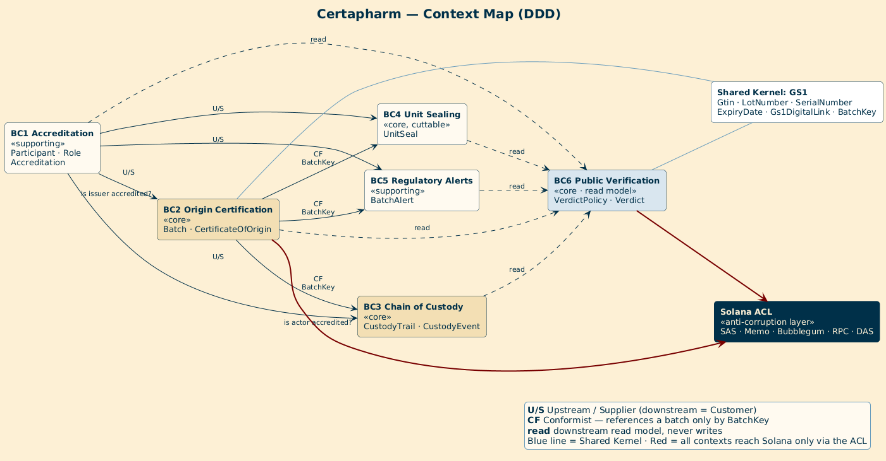
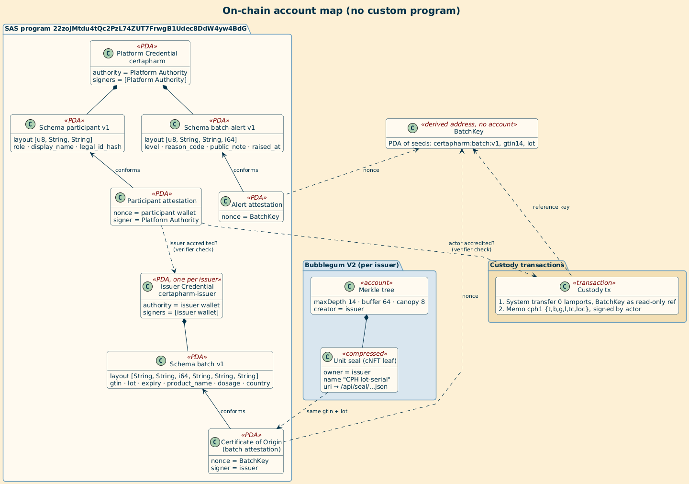
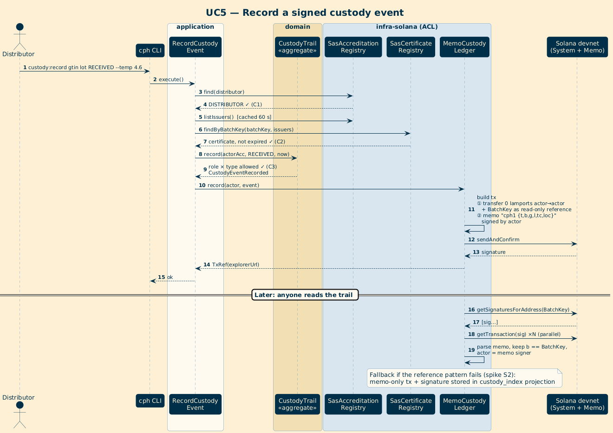
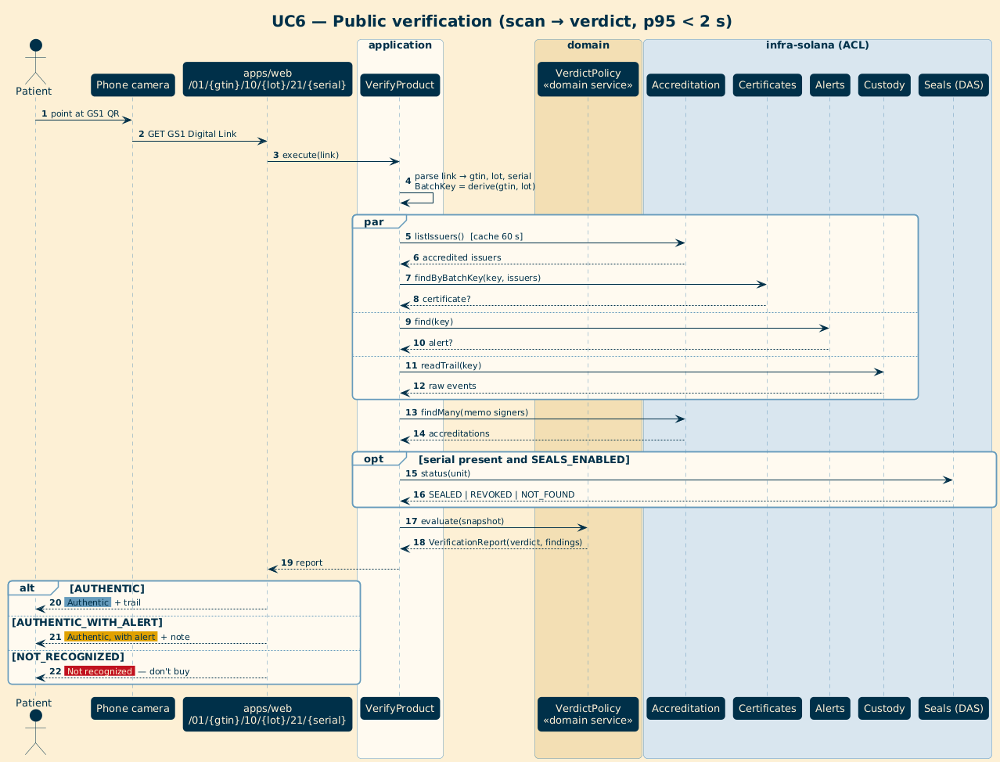
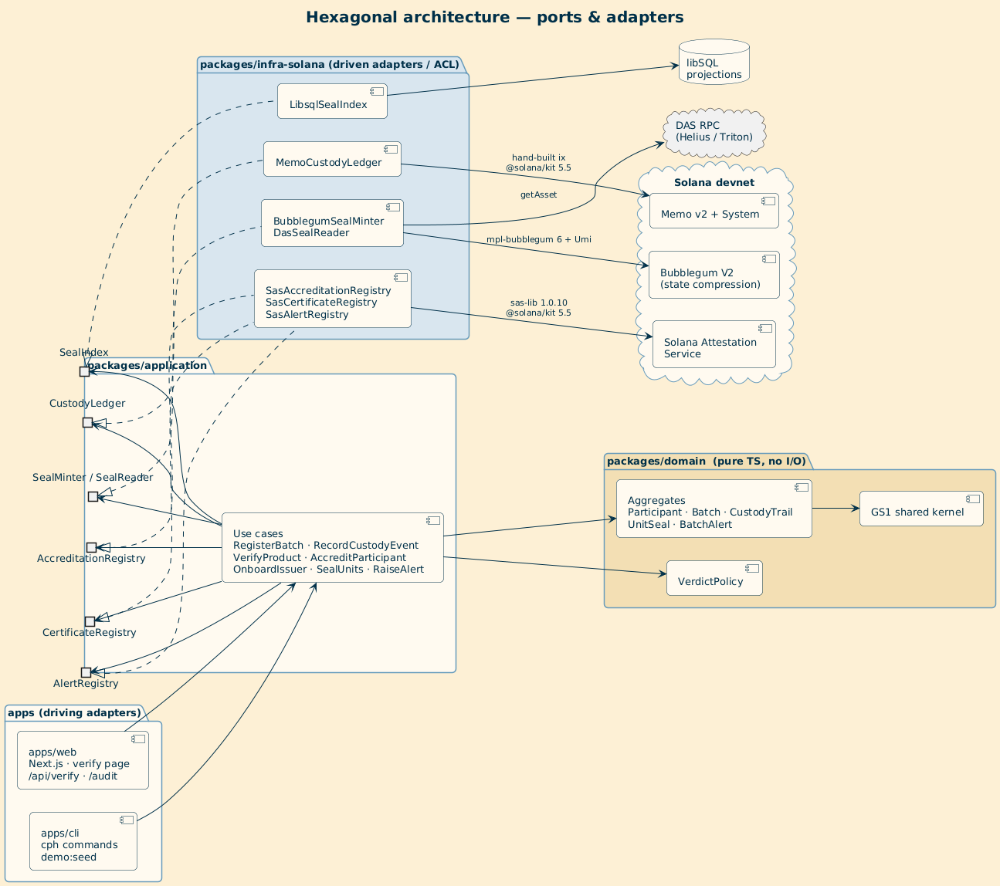
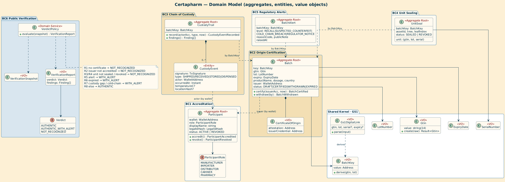
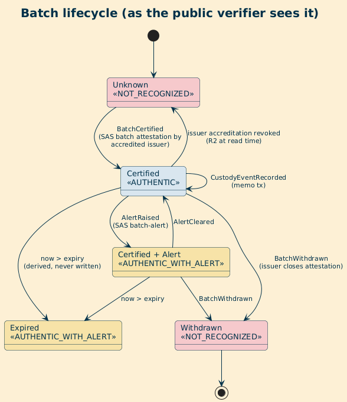
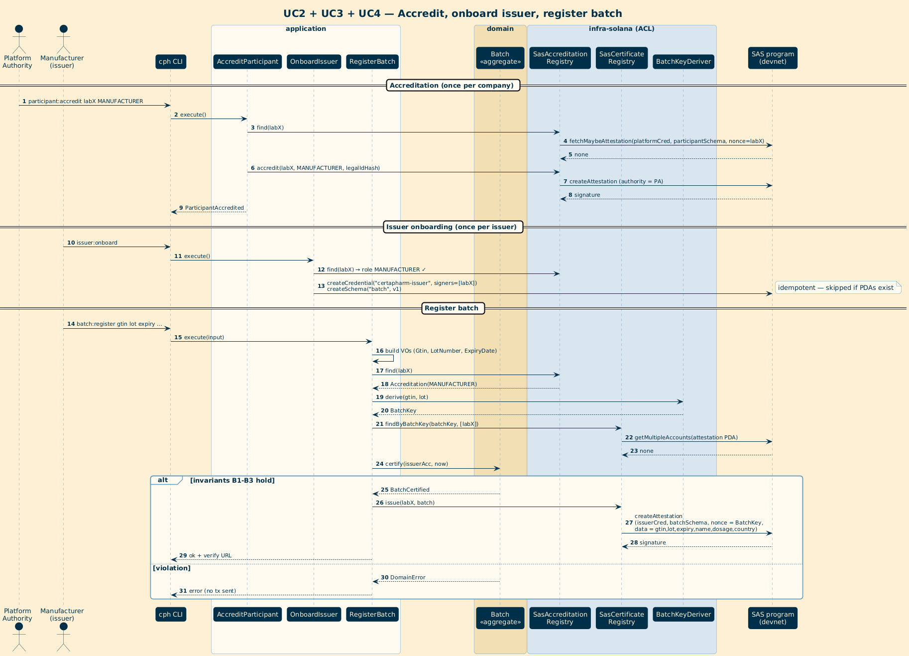

# Certapharm

Proof of origin for every medicine box, verifiable by anyone, on Solana.
Built for the Colosseum 2026 hackathon (Solana track).

## The problem

Falsified and diverted medicines reach patients because a box carries no proof that a real, accredited maker
released that lot, or that it travelled through accredited hands. Regulators keep registries, but a patient
cannot query them from a pharmacy counter, and the registries are not open to independent audit.

## What Certapharm does

A manufacturer certifies a lot. Distributors, carriers and pharmacies sign custody events as the lot moves.
A patient scans the GS1 QR code already printed on the box and gets one of three answers, with no wallet and
no account:

| Verdict | Meaning |
|---|---|
| **Authentic** | The lot was certified by an accredited maker and its custody trail is intact |
| **Authentic, with alert** | Same, but a recall or notice is active, the lot expired, or the trail has a gap |
| **Not recognized** | No valid record of this product |

Everything behind the answer is public on Solana, so a journalist, an auditor or a competing pharmacy can
re-check it without trusting Certapharm.



## Design decisions

Each decision below says what was chosen, why, and what it costs.

### 1. No custom on-chain program

**Chosen:** compose programs that already exist (Solana Attestation Service, Memo, Bubblegum) from a TypeScript SDK.
**Why:** a custom program needs an audit and an upgrade-authority story that a hackathon cannot honestly provide.
Existing programs are already deployed and reviewed, and the three things we need (signed claims, signed events,
per-unit tokens) map onto them directly.
**Cost:** business rules such as "a pharmacy cannot ship" are not enforced by the chain. See decision 5.



### 2. Two kinds of SAS credentials

**Chosen:** one Platform credential (accreditations and alerts, signed only by the Platform Authority) and one
issuer credential per manufacturer or importer (that issuer's batches, signed only by that issuer).
**Why:** SAS lets any authorized signer of a credential create or close any attestation under it. Putting two
companies on one credential would let one withdraw the other's batches. Separate credentials make "only the
issuer can withdraw its own batch" a property of the chain, not of our code.
**Verifier rule:** a batch is trusted only if its issuer also holds a participant attestation signed by the
Platform Authority with a manufacturer or importer role.

### 3. Custody events are Memo transactions indexed by a reference key

**Chosen:** each event is one transaction with a Memo (`cph1 {json}`, at most 400 bytes) signed by the actor,
plus a 0-lamport transfer that carries the `BatchKey` as an extra read-only account.
**Why:** that reference account makes `getSignaturesForAddress(batchKey)` return the whole trail, so reading a
batch needs no indexer and no database. The memo is plain JSON, so an auditor can read it without our code.
**Details:**
- The actor is the memo's signer, not the fee payer. The reader discards a memo whose claimed actor did not
  really sign the transaction, and any memo whose `b` field differs from the queried key.
- The platform pays every fee, so a distributor or a pharmacy never needs SOL.
- `@solana-program/system` is incompatible with `@solana/kit` 5.5, so the transfer instruction is built by hand
  (spike S2 confirmed it lands and is indexed).



### 4. The BatchKey is a derived address, not an account

**Chosen:** `BatchKey = PDA("certapharm:batch:v1", gtin14, lot)`. No account ever exists at that address.
**Why:** one deterministic key ties together the certificate (its nonce), the alert (its nonce) and every
custody transaction (its reference). Any machine derives the same key from the QR code alone.
The lot is case-sensitive, matching GS1 AI(10).

### 5. Rules are checked on write and reported as findings on read

**Chosen:** the role-by-event matrix (a pharmacy may dispense, a carrier may not) is enforced by the CLI when an
event is recorded. When reading, a violation does not throw. It becomes a `Finding` that downgrades the verdict.
**Why:** anyone can post a memo to the public chain, so the verifier must expect hostile input and still answer.
A memo from a wallet that is not accredited is dropped from the trail and noted as informational. It cannot
turn an authentic lot into a suspicious one, which would let anyone attack a competitor's lots.
**Cost:** enforcement is advisory on-chain. A future Anchor program could enforce it (see Roadmap).

### 6. The verdict is a pure, ordered policy

**Chosen:** `VerdictPolicy` evaluates rules R1 to R8 in order and the first "not recognized" rule wins:
no certificate, issuer not accredited, unit not sealed, unit revoked, then alert, expiry and custody problems
that lead to "authentic, with alert", and otherwise "authentic". Each rule has its own unit test.
**Why:** the verdict is the product. Keeping it a pure function over a snapshot makes it testable without a
network and identical in the CLI and the web app.



### 7. Hexagonal layout with enforced boundaries

**Chosen:** `domain` is pure TypeScript, `application` holds use cases and ports, `infra-solana` holds adapters,
the CLI is the only writer and holds keys, and the web app is read-only. ESLint forbids `@solana/*`, `sas-lib`
and `@metaplex-foundation/*` inside `domain` and `application`.
**Why:** the chain is the source of truth and the SDKs change fast. Isolating them keeps over 100 tests running
offline against in-memory fakes, and lets the web app build without any secret key.
**Conventions:** use cases return `Result` values, only adapters throw, time comes from an injected `Clock`.



### 8. Privacy by construction

**Chosen:** the CNPJ is never written anywhere. Only the SHA-256 of its digits is stored. Custody sites are
stored as the first 8 hex characters of a hash, never as an address. The patient screen uses no crypto words.
**Why:** the chain is permanent and public. Anything personal or commercially sensitive must be kept out
before it is written, because it cannot be removed afterwards.

### 9. Per-unit seals are optional

**Chosen:** compressed NFTs (Bubblegum V2) can seal individual boxes by serial number, held by the issuer.
The consumer never owns a token.
**Why:** batch-level proof covers the core promise. Unit seals add counterfeit detection per box, but cost
more and need a DAS-capable RPC, so they are the first thing to cut if time runs out.

### 10. One pin: `@solana/kit` 5.5.x

**Chosen:** the whole workspace is pinned to kit 5.5.1 through `pnpm.overrides`.
**Why:** `sas-lib` and the kit programs move on different schedules, and a mismatch broke the system program
package during the spikes. One pinned version keeps every package on the same types.

## Architecture at a glance

| Concern | Used |
|---|---|
| Accreditation, batch certificate, alerts | Solana Attestation Service (`sas-lib@1.0.10`) |
| Custody events | Memo v2 plus the BatchKey as a reference account |
| Per-unit seals | Bubblegum V2 (`mpl-bubblegum@6.0.0`, Umi) |
| Reads | RPC plus DAS |

```
packages/domain         pure TypeScript: GS1 value objects, aggregates, VerdictPolicy
packages/application    use cases and ports
packages/infra-solana   SAS, Memo and BatchKey adapters
apps/cli                `cph`, the only place that writes or holds keys
apps/web                Next.js, read-only (verification page and API)
```

Domain model and batch lifecycle:





The full specification is in `certapharm-specs/specs/`, and the PlantUML sources are next to the images.

## Current state

Working on devnet from the CLI: platform bootstrap, accreditation, issuer onboarding, batch certification and
custody events, with the adapters tested against devnet. The remaining pieces are the public `verify` use case,
the demo seed and the web verification page. Spike results with transaction links are in `apps/cli/SPIKES.md`.

## Run it

Prerequisites: Node 20+, pnpm 9, and a DAS-capable devnet RPC such as Helius.

```sh
cp .env.example .env          # set RPC_URL
pnpm install
pnpm -r build && pnpm -r test && pnpm lint
```

Keys live in `./.keys/` and are never committed. Fund the platform key with devnet SOL, then:

```sh
pnpm --filter @certapharm/cli cph keys:new platform
pnpm --filter @certapharm/cli cph platform:init
pnpm --filter @certapharm/cli cph participant:accredit --wallet labX --role MANUFACTURER --name "Laboratório Demo" --cnpj 12345678000199
pnpm --filter @certapharm/cli cph issuer:onboard --as labX
pnpm --filter @certapharm/cli cph batch:register --as labX --gtin 2001234567893 --lot L2026A \
  --expiry 2027-12-31 --product "Demo Amoxicilina 500 mg" --dosage "500 mg"
pnpm --filter @certapharm/cli cph custody:record --as labX --gtin 2001234567893 --lot L2026A --type SHIPPED
```

All demo GTINs and names are fictitious. The `200` GTIN prefix is reserved by GS1 for restricted circulation, so
it cannot collide with a real product.

## Security model and limits

- Only the Platform Authority accredits participants and raises alerts. Each issuer can create or withdraw only
  its own batches.
- Custody rules are enforced when writing and reported as findings when reading. They are not enforced on-chain.
- The Platform Authority is a single key on devnet. Production would use a multisig.
- Revoking an accreditation closes its attestation, so the verifier cannot yet tell a revoked issuer from an
  unknown one. This is a known gap.

## Roadmap

An Anchor program for on-chain custody rules, Token-2022 freeze, ERP ingestion, mainnet.

## License

Apache-2.0. The license file is still to be added.
